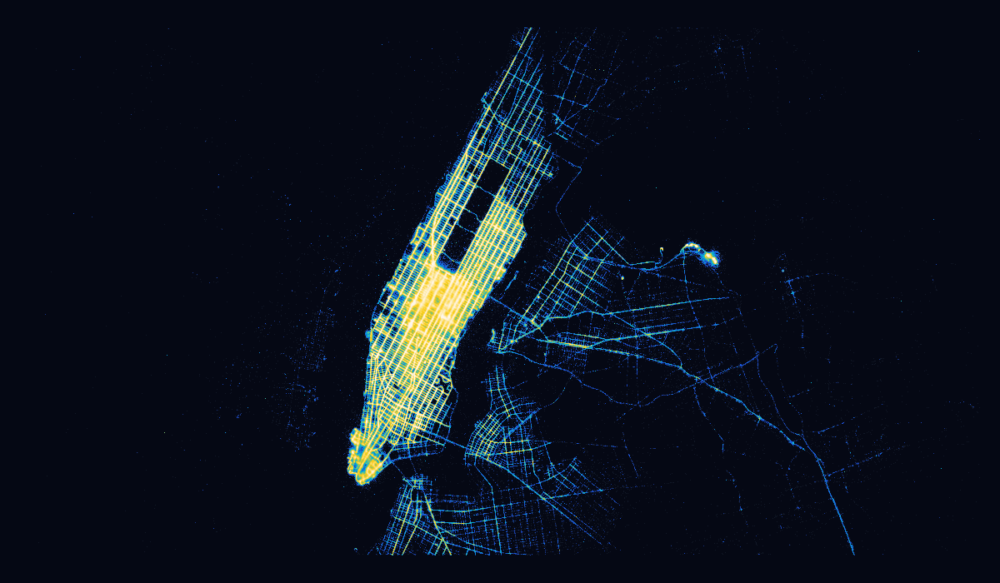

# datashader-browser

Run Datashader-powered visualizations entirely in a browser with Python and
WebAssembly—without assuming that the complete dataset fits in browser memory.

This is an early, independent project. It is not yet an official HoloViz
project and is not affiliated with or endorsed by the Datashader maintainers.

**[Open the NYC Taxi demo](https://sumayabee.github.io/datashader-browser/lab/index.html?path=nyc-taxi-tiles.ipynb)**:
11.8 million taxi pickups that you can pan and zoom in your browser, with no
install and no server. Run the cell, then scroll to zoom. The first load takes
about 30 s while the Python kernel starts; after that, each zoom takes well
under a second.

The [live browser demo](https://sumayabee.github.io/datashader-browser/) also
has the other example notebooks.

## What works now

The first vertical slice is a bounded-memory point aggregator:

```python
import datashader as ds
import datashader.transfer_functions as tf

from datashader_browser import StreamingCanvas, iter_csv_chunks, iter_parquet_batches

source = iter_csv_chunks(
    "points.csv",
    chunksize=250_000,
    columns=["longitude", "latitude", "value"],
)

canvas = StreamingCanvas(
    plot_width=1000,
    plot_height=600,
    x_range=(-180, 180),
    y_range=(-90, 90),
)
aggregate = canvas.points(source, "longitude", "latitude", agg=ds.mean("value"))
image = tf.shade(aggregate)

# A local Parquet file can yield projected Arrow record batches directly.
parquet_source = iter_parquet_batches(
    "points.parquet", columns=["longitude", "latitude"], batch_size=250_000
)
aggregate = canvas.points(parquet_source, "longitude", "latitude", agg=ds.count())
```

Only one input chunk and Datashader's fixed-size aggregate buffers are live at
once. The implementation calls Datashader's own compiler, so point binning and
reductions match native Datashader instead of being reimplemented.

Currently verified reductions are `count`, `sum`, `mean`, `min`, and `max`.
Explicit `x_range` and `y_range` values are required to preserve a true
single-pass pipeline.

## Interactive HoloViews integration

The optional HoloViews adapter connects Bokeh viewport events to repeatable,
bounded Parquet scans:

```bash
pip install "datashader-browser[data,holoviews]"
```

```python
from datashader_browser import ParquetSource
from datashader_browser.holoviews import datashade

source = ParquetSource("points.parquet", batch_size=250_000)
plot = datashade(
    source,
    "longitude",
    "latitude",
    x_range=(-180, 180),
    y_range=(-90, 90),
)
plot
```

HoloViews and Bokeh supply axes, zoom and pan tools, and dynamic plot updates.
On each viewport change, the adapter calls `StreamingCanvas` and returns a new
`RGB` element. The current PyArrow backend applies viewport predicates within
each bounded batch but still scans the file sequentially. Spatially pruned
reads remain a data-plane optimization rather than a current performance claim.

## Instant zoom with tile pyramids

Rescanning the source on every pan and zoom does not scale in a browser. A
**tile pyramid** stores Datashader's reduction state (counts, sums, minima,
maxima) at several resolutions. You build it once with ordinary Python and host
it as static files. Each viewport then reads only the few small tiles it needs.

```bash
datashader-browser build-tiles nyc_taxi_wide.parq --x pickup_x --y pickup_y \
    --x-range -8256000 -8209000 --y-range 4964000 4990000 \
    --max-level 8 --values fare_amount --workers 8 --out tiles/
```

```python
import datashader as ds
from datashader_browser import ParquetSource, TilePyramid
from datashader_browser.holoviews import datashade

pyramid = TilePyramid("https://example.org/nyc/tiles")   # or a local folder
datashade(pyramid, agg=ds.mean("fare_amount"),
          fallback=ParquetSource("nyc_taxi_wide.parq"))  # raw scan past the deepest level
```

**Same results as Datashader.** Every level is identical to
`ds.Canvas(plot_width=n, plot_height=n, ...).points(...)` over the full extent.
Counts, minima and maxima match bit for bit, and sums and means match up to
floating-point summation order. The test suite checks every level and reduction,
and the NYC benchmark repeats the check on all 11.8 million real rows. This works
because the binning reuses Datashader's own arithmetic, and doubling the grid
scales it exactly (see [Architecture](docs/architecture.md)).

**Browser results, NYC Taxi (11.8M rows)**, measured in headless Chrome 150 with
the Xeus-Python WebAssembly kernel. Each row is an 800×500 render, and tile times
are cold, fetched over HTTP:

| Viewport | Points in view | Full Parquet scan | Tile pyramid | Tiles fetched |
|---|---:|---:|---:|---:|
| All NYC | 11,842,094 | 28.6 s | 0.07 s | 16 |
| Manhattan | 11,229,897 | 26.7 s | 0.33 s | 71 |
| Midtown | 3,694,079 | 8.9 s | 0.32 s | 70 |
| Times Square | 254,473 | 0.79 s | 0.23 s | 63 |
| One block | 19,095 | 0.22 s | 0.03 s | 9 |

The scan columns also required downloading the 367 MiB Parquet file into the
browser (2.3 s on localhost). The pyramid needed only `manifest.json` plus the
visible tiles. Building that 9-level pyramid took 24 s natively with 8 threads
and produced 25,245 tiles (176 MiB, including the four `fare_amount` fields). A
7-level build is 3,208 tiles (52 MiB) and takes 6 s. Raw results are in
[`docs/benchmarks/`](docs/benchmarks/). Reproduce them with
`examples/benchmark_zoom.py` (native) and `examples/browser_benchmark.py`
(browser).

Pyramids support `count`, `sum`, `mean`, `min` and `max` on points. Other
reductions still use a scan. Try `tile-pyramid.ipynb` in the live demo.

## Use a tile pyramid in your own web map

`TileMap` renders an image overlay for a viewport. It works with a local
pyramid or an HTTP(S) URL. Install `datashader-browser[map]` for PNG output.
Create one renderer per dataset to reuse its tile cache between zooms.

```python
from datashader_browser import TileMap

tile_map = TileMap("https://example.org/tiles")
image = await tile_map.render([xmin, ymin, xmax, ymax], 800, 500)
```

Use the pyramid's coordinate system for the requested bounds. Draw
`image["url"]` over `image["bounds"]`, which are snapped to bin edges.
`width` and `height` in the result are the actual PNG dimensions.
A view entirely outside the dataset returns `None`. If you want a fixed
color scale across views, create the renderer with `how="linear"` and an
explicit `span`.

For a standalone page, start a Web Worker with a Python WebAssembly runtime
that provides `pyjs`, Datashader and Pillow. In the worker's Python startup
code, register the renderer and then signal that the worker is ready:

```python
from datashader_browser import TileMap, serve_tile_map
from pyjs import js

disconnect = serve_tile_map(TileMap("https://example.org/tiles"))
js.self.postMessage("datashader:ready")
```

Once the worker is ready, send requests from your map's viewport-change
handler. Supply the map's bounds in the pyramid's coordinate system and
use the returned bounds when positioning the overlay.

```javascript
let latest = 0;

function requestOverlay(bounds, width, height) {
  worker.postMessage({
    type: "datashader:render", id: ++latest, bounds, width, height,
  });
}

worker.addEventListener("message", ({ data }) => {
  if (data?.type !== "datashader:result" || data.id !== latest) return;
  if (data.error) {
    console.error(data.error);
    return;
  }
  updateOverlay(data.image); // Your map code places or clears the overlay.
});
```

The web app supplies the worker runtime and map UI. The tiles can be hosted
with the app on a static site or on a server that allows cross-origin reads.

## NYC Taxi real-data verification

The streaming accumulator successfully rendered all **11,842,094 pickup
locations** in HoloViz's transformed
[January 2015 NYC Taxi dataset](https://examples.holoviz.org/gallery/nyc_taxi/nyc_taxi.html).
The 385 MB Parquet file was decoded as 48 Arrow/Pandas batches of at most
250,000 rows; the complete table was never materialized as one DataFrame.



One warm-cache Linux run produced the 1200-by-700 image in 3.24 seconds with
514 MiB peak process RSS. Runtime and memory will vary by machine. Reproduce it
with:

```bash
uv sync --extra data
uv run python examples/nyc_taxi.py --download
```

This benchmark validates `StreamingCanvas` against a real large dataset on
native Python. The same file has also been streamed end to end **inside the
browser**: the full 367 MiB Parquet scan of all 11.8 million rows completed in
28.6 s in the Xeus-Python WebAssembly kernel (see the table above). Browser
peak memory has not yet been measured.

## Browser runtime

The initial deployment target is JupyterLite with the Xeus-Python WebAssembly
kernel. Its environment is described in [`environment.yml`](environment.yml)
and uses the experimental Numba and llvmlite packages from emscripten-forge.
The kernel executes in a Web Worker, keeping aggregation off the browser UI
thread. The Parquet-capable build is currently about 256 MB because PyArrow
brings compiled Arrow and compression dependencies; this is an engineering
baseline, not the final delivery architecture. The first visit therefore needs
a substantial download, while subsequent use benefits from the browser cache.

Browser verification: `streaming-parquet.ipynb` has been run end-to-end in the
Xeus-Python WebAssembly kernel. It created a 57.2 MB, two-million-row Parquet
file in the browser filesystem, streamed it through 20 Arrow batches, checked
the final row count, and rendered the shaded aggregate with no browser console
errors. The full NYC Taxi file has since been scanned in the browser as well
(see the tile pyramid section). `interactive-parquet.ipynb` is the HoloViews integration example; browser
interaction validation is tracked separately from the existing static render.

```bash
uv sync --extra test
uv run pytest

# Build the browser site (requires the build dependencies below).
uv pip install -r requirements-build.txt
uv run jupyter lite build \
  --XeusAddon.environment_file=environment.yml \
  --contents content \
  --output-dir dist
```

### Browser workarounds

`datashader-browser` works around three problems in the current
JupyterLite/Xeus-Python stack so interactive HoloViews plots work in the
browser. They apply only in a browser kernel:

- Xeus-Python registers an empty placeholder `tornado` module that hides the
  real one, so HoloViews' Bokeh backend could not import. It is replaced
  with the real package.
- BokehJS and Panel are embedded inline. Loading them from the CDN raced
  the first plot, which then stayed blank.
- Xeus-Python (0.19.0, and `main` at the time of writing) rejects comms
  opened by the page, so pan and zoom events never reached Python. The page
  now registers a comm target and Python opens the channel after the cell
  runs. Kernel-opened comms work, and comms carry messages both ways.

`examples/browser_demo_check.py` checks this end to end. It runs the NYC
notebook in JupyterLab under headless Chrome, zooms with the mouse wheel and
confirms that Python re-rendered from deeper pyramid levels.

## Large-data strategy

“In the browser” does not mean that an unlimited dataset can be copied into a
Pandas DataFrame. The project uses three execution levels:

1. **Stream:** scan CSV or local Parquet/Arrow batches through a bounded-memory Datashader
   accumulator. Total row count affects time, not peak aggregate memory.
2. **Prune:** use Parquet row groups, spatial partitions, and DuckDB-Wasm to
   read only the viewport and required columns.
3. **Tile (implemented):** fetch precomputed multi-resolution aggregate tiles
   instead of rescanning the source on every zoom.

See [Architecture](docs/architecture.md), [Research](docs/research.md), and the
[roadmap](ROADMAP.md) for the engineering decisions and current limitations.

## Progressive rendering

`StreamingCanvas.points(..., on_partial=callback, partial_every=4)` passes the
callback a finalized aggregate of everything scanned so far, so a long scan can
show an image that fills in while it runs.

## Status

This repository is an alpha-stage research implementation. The WebAssembly
Numba/llvmlite stack works in current demonstrations but its patches have not
yet been fully upstreamed. Production use should wait for reproducible browser
builds, compatibility CI, and measured browser memory limits.

## License

BSD-3-Clause. Datashader is a separate BSD-3-Clause project owned by its
respective copyright holders and contributors.
